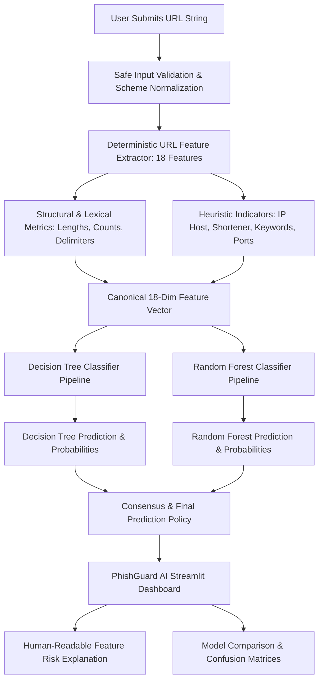

# PhishGuard AI — Implementation Plan

**Title:** Phishing Website Detection Using URL-Based Feature Extraction with Decision Tree and Random Forest Algorithms  
**Application Name:** PhishGuard AI  
**Tagline:** Detect Phishing. Browse Safely.  
**Domain:** Fundamentals of Machine Learning — Supervised Classification

---

## 1. System Architecture & Methodology

---

## 2. Target Classes & Primary Supervised ML Classifiers

- **Classes:**
  - `Legitimate` (Class 0): Authentic, safe domain and URL structure.
  - `Phishing` (Class 1): Malicious, deceptive, or spoofed URL structure.
- **Classifier 1: Decision Tree Classifier (DT)**
  - Algorithm: CART algorithm via `scikit-learn.tree.DecisionTreeClassifier`.
  - Splitting criterion: Gini Impurity.
  - Transparent tree structure with explainable decision paths.
- **Classifier 2: Random Forest Classifier (RF)**
  - Algorithm: Bagging ensemble of 100+ decorrelated decision trees via `scikit-learn.ensemble.RandomForestClassifier`.
  - Combines multiple bootstrap trees to reduce variance and compute feature importances.

---

## 3. Canonical 18-Dimensional URL Feature Schema

1. `url_length`: Overall character count of the URL.
2. `hostname_length`: Character count of domain/host.
3. `path_length`: Length of path component.
4. `query_length`: Length of query string.
5. `count_dots`: Total '.' occurrences in URL.
6. `count_hyphens`: Total '-' occurrences in URL.
7. `count_at`: Total '@' occurrences (userinfo spoofing indicator).
8. `count_question`: Total '?' occurrences.
9. `count_equal`: Total '=' occurrences.
10. `count_ampersand`: Total '&' occurrences.
11. `count_percent`: Total '%' occurrences (hex/percent encoding obfuscation).
12. `count_digits`: Total numerical digits across URL.
13. `count_subdomains`: Depth of subdomains in hostname.
14. `is_ip_address`: 1 if hostname is an IPv4/IPv6 literal, else 0.
15. `is_https`: 1 if scheme is HTTPS, else 0.
16. `is_shortener`: 1 if domain matches known URL shorteners, else 0.
17. `has_suspicious_keyword`: 1 if URL contains sensitive credential-harvesting keywords, else 0.
18. `has_unusual_port`: 1 if non-standard HTTP/HTTPS port specified, else 0.

---

## 4. Implementation Stages

- **Stage 1: Workspace & Backup:** Back up old music project to `backup_previous_music_project/`, initialize clean `PhishGuard-AI/`.
- **Stage 2: Environment:** Python 3.11 `.venv`, install scikit-learn, pandas, numpy, streamlit, plotly, pytest.
- **Stage 3: Dataset Preparation:** Ingest verified labeled phishing and legitimate URL dataset, extract canonical features, and create stratified 80/20 train/test split.
- **Stage 4: Feature Extraction:** Implement `url_features.py` with robust regex, `urllib.parse`, and `ipaddress`.
- **Stage 5: Machine Learning Training & Evaluation:** Train Decision Tree and Random Forest, benchmark on held-out test split, and persist artifacts.
- **Stage 6: Multi-Page Web Interface:** Build Streamlit interface (`app.py`, `1_URL_Feature_Analysis.py`, `2_Model_Comparison.py`, `3_About_Project.py`).
- **Stage 7: Quality Assurance:** Automated pytest suite, compile checks, edge-case testing, and documentation.

