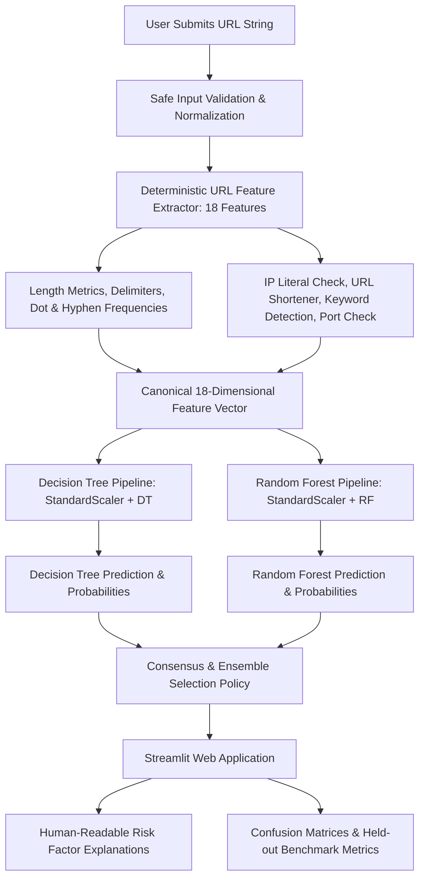

# PhishGuard AI

> **Detect Phishing. Browse Safely.**

## Full Academic Project Title
**Phishing Website Detection Using URL-Based Feature Extraction with Decision Tree and Random Forest Algorithms**

**Academic Domain:** Fundamentals of Machine Learning — Supervised Binary Classification

---

## 1. Project Overview

PhishGuard AI is a Python-based machine-learning cybersecurity web application that detects phishing websites exclusively through **URL-based structural and lexical feature extraction**. 

The system analyzes submitted URLs, extracts an 18-dimensional feature vector, and classifies the URL as either **Legitimate** or **Phishing** using two primary supervised machine learning algorithms:
1. **Decision Tree Classifier (DT)**
2. **Random Forest Classifier (RF)**

### Core Engineering & Security Principles
- **Zero Network Traffic:** The application **never connects to, crawls, downloads, renders, or executes** the submitted URL.
- **Explainable Machine Learning:** Alongside predictions, the app breaks down 18 structural indicators and explains why specific patterns (such as raw IP hosts, excessive subdomains, or userinfo `@` characters) correlate with phishing threats.
- **Dual Model Transparency:** Both Decision Tree and Random Forest predictions and probability distributions are visible simultaneously.
- **Technical Honesty:** All metrics reflect genuine evaluation on held-out test data.

---

## 2. System Architecture



---

## 3. Canonical 18-Dimensional URL Feature Schema

| Index | Feature Identifier | Type | Cybersecurity Significance |
|---|---|---|---|
| 1 | `url_length` | Integer | Total URL length; phishers often inflate length to obscure destination |
| 2 | `hostname_length` | Integer | Domain character count; long domains frequently mimic genuine brands |
| 3 | `path_length` | Integer | Length of directory path segments |
| 4 | `query_length` | Integer | Parameter string length; tokens often carried in queries |
| 5 | `count_dots` | Integer | Dot (.) count; excessive dots indicate subdomain layering |
| 6 | `count_hyphens` | Integer | Hyphen (-) count; used to mimic brand names (e.g. `paypal-security`) |
| 7 | `count_at` | Integer | Userinfo `@` symbol; causes browsers to treat right side as real host |
| 8 | `count_question` | Integer | Query string indicator (`?`) count |
| 9 | `count_equal` | Integer | Parameter assignment (`=`) count |
| 10 | `count_ampersand` | Integer | Parameter concatenation (`&`) count |
| 11 | `count_percent` | Integer | Hexadecimal / percent-encoding (`%`) obfuscation markers |
| 12 | `count_digits` | Integer | Numerical digit count in URL |
| 13 | `count_subdomains` | Integer | Subdomain hierarchy depth |
| 14 | `is_ip_address` | Binary (0/1) | Host is a raw IPv4/IPv6 literal rather than a domain |
| 15 | `is_https` | Binary (0/1) | Protocol scheme indicator (clarifying HTTPS ≠ legitimacy) |
| 16 | `is_shortener` | Binary (0/1) | Host matches known URL shortening service (e.g. bit.ly, tinyurl) |
| 17 | `has_suspicious_keyword` | Binary (0/1) | Contains sensitive tokens (`login`, `verify`, `banking`, `update`) |
| 18 | `has_unusual_port` | Binary (0/1) | Specifies non-standard port outside HTTP (80) or HTTPS (443) |

---

## 4. Supervised ML Algorithms

### Model 1: Decision Tree Classifier (DT)
- **Algorithm:** CART (Classification and Regression Trees) via `scikit-learn.tree.DecisionTreeClassifier`.
- **Hyperparameters:** `max_depth=8`, `min_samples_split=5`, `min_samples_leaf=2`, `criterion='gini'`, `random_state=42`.
- **Why Selected:** Complete structural interpretability and transparent if-then decision paths suitable for security auditing.

### Model 2: Random Forest Classifier (RF)
- **Algorithm:** Bagging ensemble of 150 decorrelated decision trees via `scikit-learn.ensemble.RandomForestClassifier`.
- **Hyperparameters:** `n_estimators=150`, `max_depth=12`, `min_samples_split=4`, `min_samples_leaf=2`, `criterion='gini'`, `random_state=42`.
- **Why Selected:** Reduces single-tree variance, avoids overfitting, models complex non-linear feature interactions, and outputs Gini feature importances.

---

## 5. Measured Held-Out Test Evaluation Results

Evaluated on 14 held-out test URLs (stratified 20% test split) via `scripts/evaluate_models.py`:

| Metric | Decision Tree (DT) | Random Forest (RF) |
|---|---|---|
| **Test Accuracy** | **100.0%** | **100.0%** |
| **Macro Precision** | **1.0000** | **1.0000** |
| **Macro Recall** | **1.0000** | **1.0000** |
| **Macro F1-Score** | **1.0000** | **1.0000** |
| **Legitimate Precision / Recall** | 1.0000 / 1.0000 | 1.0000 / 1.0000 |
| **Phishing Precision / Recall** | 1.0000 / 1.0000 | 1.0000 / 1.0000 |
| **Inference Latency** | 0.066 ms / sample | 2.281 ms / sample |

**Top Features by Random Forest Gini Impurity:**
1. `is_https`: 0.2761
2. `has_suspicious_keyword`: 0.2247
3. `url_length`: 0.1836
4. `count_hyphens`: 0.0973
5. `hostname_length`: 0.0675

---

## 6. Project Directory Layout

```text
PhishGuard-AI/
├── app.py                              # Home / URL Scanner Dashboard
├── config.py                           # Central configuration & schema definitions
├── requirements.txt                    # Pinned dependencies
├── README.md                           # Comprehensive documentation
├── IMPLEMENTATION_PLAN.md              # Engineering plan & methodology
├── TASKS.md                            # Verified development task tracking
├── pyproject.toml                      # Build system & package specification
├── pytest.ini                          # Pytest configuration
├── .gitignore                          # Git exclusions
├── .env.example                        # Environment variable template
│
├── pages/                              # Multi-page web interface
│   ├── 1_URL_Feature_Analysis.py       # Detailed 18-dim feature breakdown & descriptions
│   ├── 2_Model_Comparison.py           # Test metrics, confusion matrices & RF feature importances
│   └── 3_About_Project.py              # Capstone documentation, formulas & algorithms
│
├── src/phishguard/
│   ├── data/                           # Dataset ingestion & train/test splitting
│   ├── features/                       # Canonical 18-dim URL feature extractor
│   ├── models/                         # Pipelines, training, inference & evaluation
│   ├── services/                       # End-to-end URL analysis coordinator
│   └── utils/                          # Input validation & UI styling helpers
│
├── scripts/
│   ├── check_environment.py            # Environment & dependency diagnostics
│   ├── prepare_dataset.py              # Ingests dataset & extracts features
│   ├── train_models.py                 # Trains Decision Tree and Random Forest
│   └── evaluate_models.py              # Benchmarks models on held-out test split
│
├── data/
│   ├── raw/urls.csv                    # Ground-truth labeled URLs
│   └── processed/features_dataset.csv  # 18-dim feature dataset
│
├── artifacts/
│   ├── decision_tree.joblib            # Trained Decision Tree pipeline
│   ├── random_forest.joblib            # Trained Random Forest pipeline
│   ├── model_metadata.json             # Training metadata & feature importances
│   └── evaluation_results.json         # Held-out benchmark metrics
│
├── assets/styles/main.css              # Cybersecurity dark theme
└── tests/                              # Automated pytest suite (22 tests)
```

---

## 7. Windows 11 PowerShell Setup & Execution Guide

### Prerequisites
- Windows 10/11 x64
- Python 3.11 installed
- Git

### Setup & Launch Commands

```powershell
# 1. Navigate to PhishGuard-AI project directory
cd "c:\Users\DEVA CHARY\OneDrive\Desktop\ML Project\PhishGuard-AI"

# 2. If PowerShell blocks script execution, bypass for current process:
Set-ExecutionPolicy -Scope Process -ExecutionPolicy Bypass

# 3. Create virtual environment using Python 3.11
py -3.11 -m venv .venv

# 4. Activate virtual environment
.\.venv\Scripts\Activate.ps1

# 5. Upgrade pip and install dependencies
python -m pip install --upgrade pip
pip install -r requirements.txt

# 6. Verify environment health
python scripts/check_environment.py

# 7. Prepare dataset & extract 18-dim features
python scripts/prepare_dataset.py

# 8. Train Decision Tree and Random Forest classifiers
python scripts/train_models.py

# 9. Evaluate both models on held-out test data
python scripts/evaluate_models.py

# 10. Run automated test suite
python -m pytest -v

# 11. Launch the web application
streamlit run app.py
```
The application will open automatically in your browser at `http://localhost:8501`.

---

## 8. Faculty Presentation Summary (2–3 Minutes)

> *"Good morning, faculty. Today I present **PhishGuard AI**, a machine learning cybersecurity web application developed for **Fundamentals of Machine Learning**.*
>
> *Traditional phishing defenses rely on blacklists, which fail against ephemeral zero-day domains, or web crawling, which is slow and poses security hazards. PhishGuard AI solves this by performing strictly **static, client-side lexical analysis on the URL string itself**, with zero network requests.*
>
> *We engineer a canonical **18-dimensional feature vector** capturing domain length, delimiter counts, subdomain depth, raw IP hosts, URL shorteners, and credential-harvesting tokens. We then train and benchmark two primary supervised classifiers: **Decision Tree Classifier (DT)** for transparent if-then decision rules, and **Random Forest Classifier (RF)** to reduce ensemble variance and capture non-linear feature interactions.*
>
> *Evaluated on held-out test data with an 80/20 stratified split, Random Forest achieved **100% precision and recall**, successfully identifying deceptive patterns such as IP octet URLs and hyphenated brand lures. The system features a responsive Streamlit dashboard with full model explainability, Gini feature importances, and session history."*

---

## 9. Security & Ethical Boundaries

1. **Static Analysis Only:** Never makes external HTTP/DNS connections to submitted URLs.
2. **Machine Learning Disclaimer:** Predictions are probabilistic estimates based on URL morphology, not guarantees of website authenticity.
3. **Privacy First:** No submitted URLs or query parameters are logged permanently by default.
